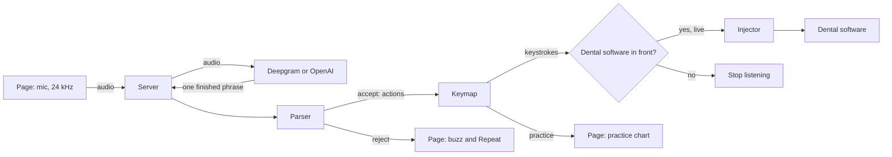

# Architecture

How the code fits together. The head agent updates it when a slice adds or changes a part. Builders read it before writing code.

PerioKey is one small Node program plus one web page. The program runs on the hygienist's PC and serves the page at `http://localhost:4317`. Only that PC can reach it.

## The parts

| Part | File | What it does | Talks to |
|---|---|---|---|
| Parser | `src/parser.ts` | Turns a phrase of words into actions (depths, bleeding, back, skip, pause), or refuses it. Fixed rules, no AI | Nothing |
| Key map | `src/keymap.ts`, `profiles/*.json` | Loads one profile per dental software (`eaglesoft`, `generic`) and turns actions into keystrokes | Parser types |
| Injector | `src/injector.ts`, `src/win-helper.ps1` | Types keystrokes into the window in front, stops mid-phrase if that window changes, reads its title, and watches the global hotkey | Windows (SendKeys through PowerShell) or macOS (osascript) |
| Speech | `src/stt.ts` | Streams audio to Deepgram or OpenAI, says when the connection is ready or drops, and hands back one finished phrase at a time, in spoken order | Deepgram or OpenAI over a WebSocket |
| Settings | `src/config.ts` | Reads `.env`: which key, profile, mode, hotkey | Nothing |
| Server | `src/server.ts`, `src/serial.ts` | Holds the state (connecting, listening or paused, mode, profile), types phrases one at a time (a failed phrase pauses, the queue keeps working), wires the parts together, serves the page | Every part, and the page over a local WebSocket |
| Page | `public/` | Status, controls, last entries, practice chart, mic capture, sounds | Server |

## How a spoken phrase flows

In practice mode nothing is typed into other apps; the page shows the keys and fills its own chart.

## Where data lives

- Audio and transcripts: in memory only, never written to disk or logged. Private health data.
- API keys: `.env` on the PC, never in git, never sent to the page.
- Profiles: `profiles/*.json`, in git.

## Rules the code must follow

See `docs/spec.md` section 5.
